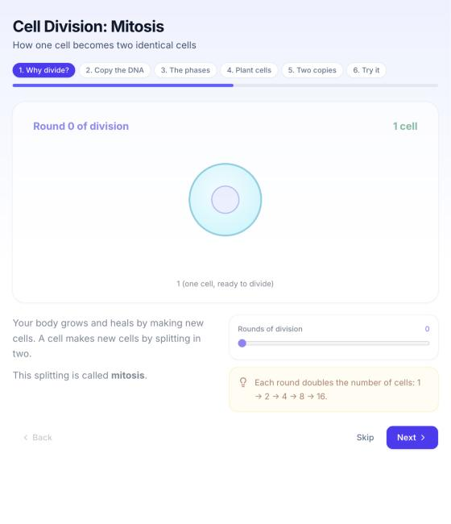
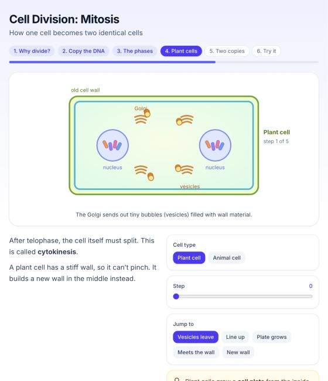
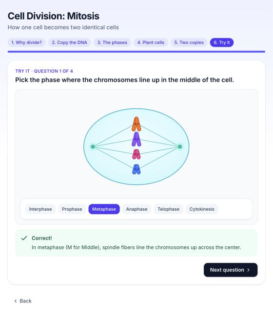

# Learn Lab: hackathon guide

A student types a topic. Claude builds a small interactive lesson. The lesson runs in a Daytona sandbox, and your page shows it live. The student asks for changes, and Claude edits the same lesson.

The starter project is ready in the `learn-lab/` folder. I tested the Claude part live with your key. I did not test the Daytona and Nosana parts, because I do not have keys for them. Section 12 lists exactly what is tested and what is not.

---

## 0. Quick start: test it in 2 minutes

You only need your Claude key for this. On this Mac, I already installed the packages and made the keys file (`learn-lab/.env.local`). Therefore you only need two commands.

Open the **Terminal** app. Go into the project folder:

```bash
cd ~/Desktop/learn-lab-hackathon/learn-lab
```

Start the app:

```bash
npm run dev
```

Then open http://localhost:3000 in your browser.

1. Wait until the right side says "Ask for a topic". The first start takes about 1 minute, because it installs the lesson packages one time.
2. Click a topic, for example **Cell division**. Or type your own topic and press Enter.
3. Wait 2–4 minutes. The lesson appears on the right. **Keep the page open** while it builds, because a reload starts a new, empty lesson.
4. Type a change, for example "Make the cells bigger", and press Enter.

To stop the app, click the Terminal window and press **Control + C**.

### What "Local test mode" means

The page shows a yellow **Local test mode** badge. It means: there is no Daytona key, so the lesson runs on your laptop at http://localhost:5173 instead of in a cloud sandbox.

This is safe for testing, because in this mode Claude can only write lesson files. It cannot run any command on your laptop.

When you get a Daytona key, put it in `learn-lab/.env.local` after `DAYTONA_API_KEY=`. Then stop the app and start it again. Now every student gets a cloud sandbox, and the badge goes away. (Do section 6, steps 4 and 5 first.)

### On another computer (from GitHub)

The code is on GitHub at https://github.com/mehmetdedeler/learn-lab-hackathon (private). The keys are **not** on GitHub, so you add them again:

```bash
git clone https://github.com/mehmetdedeler/learn-lab-hackathon.git
```

```bash
cd learn-lab-hackathon/learn-lab
```

```bash
npm install
```

```bash
cp .env.local.example .env.local
```

Open `.env.local`, paste your Claude key after `ANTHROPIC_API_KEY=`, and save. Then run `npm run dev`.

---

## 1. Your idea, in kid words

Think of a robot teacher with a magic whiteboard.

1. The student says: "Teach me cell division."
2. The robot (Claude) draws a lesson on the whiteboard. The lesson has pictures that move when you touch them.
3. The whiteboard (the Daytona sandbox) is in the cloud. Each student gets their own whiteboard.
4. The student says: "Show me how plant cells split." The robot does not wipe the board. It adds to the drawing that is already there.

These are real lessons that Claude built in my test:

| Step with a slider | Plant cell step (added on request) | Quiz with a visual |
|---|---|---|
|  |  |  |

In the quiz, the student picks "Metaphase" and the cell changes on screen. The chromosomes line up. Then a green box explains the answer.

---

## 2. Words you need

- **Sandbox**: a small computer in the cloud that you rent by the minute. It is separate from your laptop, so AI-written code cannot hurt your laptop.
- **Snapshot**: a saved copy of a ready sandbox. New sandboxes start from it in seconds, so you do not install packages every time.
- **Port**: a numbered door on a computer. The lesson's web server uses door 5173.
- **Preview URL**: a web address that shows what runs behind a door in the sandbox. Example: `https://5173-<sandbox-id>.proxy.daytona.work` (the exact domain can be different).
- **iframe**: a box on your page that shows another web page. Your right half is an iframe.
- **API key**: a secret password for a service. Anyone who has it can spend your credits.
- **Agent**: Claude working in a loop with tools. It reads, writes and checks files again and again until the job is done.
- **Tool**: a function that Claude can ask your server to run. Example: `write_file`.
- **Vite**: the program that turns the lesson code into a web page. It updates the page when a file changes.
- **GPU**: a chip that runs AI models fast. Nosana rents GPUs.
- **Container**: a packed program with everything it needs. Nosana runs containers on its GPUs.

---

## 3. Where each piece runs

```
 STUDENT'S BROWSER
 ┌──────────────────────┬───────────────────────────────┐
 │ left: chat           │ right: iframe (the lesson)    │◄─────────┐
 └─────────┬────────────┴───────────────────────────────┘          │
           │ only text, no keys                                     │ preview URL
           ▼                                                        │
 YOUR SERVER  (learn-lab, runs on your laptop)                      │
 holds the keys in .env.local                                       │
           │ ANTHROPIC_API_KEY             │ DAYTONA_API_KEY        │
           ▼                               ▼                        │
     CLAUDE (Anthropic) ──"write file"──► DAYTONA SANDBOX ──────────┘
                                          runs the lesson (Vite, port 5173)

     later: NOSANA GPU runs a speech model, and your server calls it
```

There are three places:

1. **Your laptop** runs your own app (chat on the left, iframe on the right). It holds all the keys.
2. **Daytona's cloud** runs one sandbox per student. The lesson lives there.
3. **Nosana's GPUs** run the speech model later.

---

## 4. What is in the `learn-lab/` folder

| File | What it does |
|---|---|
| `app/page.tsx` | Your page: chat on the left, live lesson on the right, PDF upload, "Fix it" button. |
| `app/api/session/route.ts` | Starts a new sandbox when the page opens. |
| `app/api/chat/route.ts` | Sends the student's message to the agent. |
| `app/api/upload/route.ts` | Takes a lecture PDF and turns it into a topic list. |
| `lib/agent.ts` | The agent: Claude's instructions, its 4 tools, and the check-and-fix loop. |
| `lib/sandbox.ts` | Creates sandboxes, starts Vite, wakes sleeping sandboxes. With no Daytona key, it uses local test mode. |
| `lib/local-box.ts` | Local test mode: the lesson runs in a folder on your laptop. |
| `lib/topics.ts` | Claude reads a PDF and returns topics with a visual idea for each. |
| `lib/config.ts` | Two names: the app folder in the sandbox and the snapshot name. |
| `scripts/hello-sandbox.mts` | A first test: makes a sandbox, says hello, deletes it. |
| `scripts/make-template.mts` | Builds the snapshot `learn-template` from the `template/` folder. |
| `template/` | The starter lesson app that goes into every sandbox. |
| `template/src/kit.jsx` | The **UI kit**: polished building blocks for every lesson. |
| `template/src/main.jsx` | Catches crashes and reports them to your page. |
| `.env.local.example` | A sample of the keys file. |

---

## 5. Keys: where they go

Short answer: all keys go into **one file on your laptop**, `learn-lab/.env.local`. They do **not** go into the sandbox, and they never go to the browser.

Here is why. Your server is the only part that talks to Claude and to Daytona. The browser only sends text to your server. For example, the student types "photosynthesis". The browser sends that word to `/api/chat`. Then your server adds `ANTHROPIC_API_KEY` and calls Claude. Then Claude asks to write a file, and your server uses `DAYTONA_API_KEY` to write it into the sandbox.

The sandbox needs no key, because it only shows the lesson. Also, the lesson code is written by AI, and the preview link is public. Therefore anything you put in the sandbox can leak.

### The keys you need

| Name | From | When |
|---|---|---|
| `ANTHROPIC_API_KEY` | You have it already (`~/Desktop/KEYS/.env`) | Now |
| `DAYTONA_API_KEY` | Daytona dashboard (section 6, step 3) | Now |
| `NOSANA_API_KEY` | Nosana dashboard (section 9) | Later, for speech |

### Make the keys file

On this Mac I already made it, with your Claude key and an empty Daytona line. So you only need to paste the Daytona key later. Use the steps below on a new computer, or if you delete the file.

Open the Terminal and go into the project folder (change the path if you moved it):

```bash
cd learn-lab
```

Copy your Claude key from your keys file into a new `.env.local` file:

```bash
grep '^ANTHROPIC_API_KEY=' ~/Desktop/KEYS/.env > .env.local
```

Add an empty line for the Daytona key:

```bash
echo 'DAYTONA_API_KEY=' >> .env.local
```

While this line is empty, the app runs in local test mode (section 0). When you have your Daytona key, open `.env.local` in a text editor and paste the key right after `DAYTONA_API_KEY=`. Do not put any other text there, because any text after `=` turns on cloud mode. The file then looks like this:

```
ANTHROPIC_API_KEY=sk-ant-...
DAYTONA_API_KEY=dtn_...
```

### Key safety rules

- Never put `NEXT_PUBLIC_` in front of a key name. That prefix sends the value to the browser.
- `.env.local` is already in `.gitignore`, so git does not upload it. Check with `git status` before you push: `.env.local` must not be in the list.
- If you put the app online (section 10), add the same names in the host's settings, not in the code.
- If a key leaks, delete it in the dashboard and make a new one.
- Your `~/Desktop/KEYS/.env` file can be read by other users on this Mac. To make it private, run `chmod 600 ~/Desktop/KEYS/.env`.

### When would a sandbox need a key?

Only if you run an AI program inside the sandbox (for example, Claude Code itself). This project does not do that. If you ever need it, use Daytona's `secrets` option: it keeps the real key out of the sandbox.

---

## 6. Daytona, step by step

Do these steps in order. Each step has a "done when" check.

### Step 1: Check Node.js

Your Mac has Node.js 23. That is good, because the project needs Node 20 or newer. Check it:

```bash
node -v
```

Done when: you see `v20` or a higher number.

### Step 2: Install the project

```bash
cd learn-lab
```

```bash
npm install
```

Done when: the command ends with no red `ERR!` lines.

### Step 3: Make a Daytona account and key

1. Go to https://app.daytona.io and sign up. Verify your email, because a verified email gives you more resources.
2. Add the hackathon credits: open **Billing → Wallet** (https://app.daytona.io/dashboard/billing/wallet). Type the code into **Redeem coupon** and click **Redeem**.
3. Make a key: open **Keys** (https://app.daytona.io/dashboard/keys) and click **Create Key**.
4. Give it a name, for example `learn-lab`. Turn on these permissions: `write:sandboxes`, `delete:sandboxes`, `write:snapshots`.
5. Click **Create** and copy the key at once. Many dashboards show a key only one time.
6. Paste it into `learn-lab/.env.local` (see section 5).

Done when: `.env.local` has two lines, `ANTHROPIC_API_KEY=...` and `DAYTONA_API_KEY=...`.

### Step 4: Your first sandbox

```bash
npx tsx --env-file=.env.local scripts/hello-sandbox.mts
```

This makes a sandbox, runs `echo Hello` in it, prints the Node version, and deletes it.

Done when: you see `Hello from the sandbox` and `Deleted. All good!`.

### Step 5: Make the template snapshot

```bash
npx tsx --env-file=.env.local scripts/make-template.mts
```

This takes a few minutes. The script does five things:

1. It starts a setup sandbox.
2. It uploads the `template/` folder (the lesson app and the UI kit).
3. It runs `npm install` inside the sandbox.
4. It runs a test build.
5. It saves everything as the snapshot `learn-template`, and then deletes the setup sandbox.

You do this **one time**. Do it again only after you change something in `template/`. Example: you make the kit's buttons bigger, then you run the script again.

Done when: you see `Done. New sandboxes can now start from 'learn-template'.` You can also see the snapshot in the dashboard under **Snapshots**.

If the Node version that it prints is lower than 20.19, Vite cannot run. See "Node is too old" in section 11.

### Step 6: Run your app

```bash
npm run dev
```

Open http://localhost:3000 in your browser.

1. The right side says "Starting your sandbox…" for about 10-30 seconds.
2. Then the right side shows "Ask for a topic".
3. Click **Cell division**, or type a topic and press Enter.
4. Wait 1-3 minutes. The lesson appears on the right.
5. Ask for a change, for example "Make the cell bigger" or "Show how plant cells split".

Done when: you see a lesson with tabs, a moving visual and a quiz.

**Check this one time:** Daytona sometimes shows a warning page the first time a browser opens a preview link. If you see it inside the iframe, click through it once. If it blocks the iframe, tell me, and we switch to Daytona's signed preview links.

### Good to know about Daytona

- **Auto-stop.** A sandbox goes to sleep after 30 minutes without activity (we set this in `lib/sandbox.ts`). The running Vite server does not count as activity. When a sleeping sandbox gets a new message, the code wakes it and starts Vite again.
- **Auto-delete.** A sandbox is deleted 60 minutes after it stops. This keeps your credits safe.
- **Limits.** A new account can run about 10 vCPU (virtual processors) at the same time. Each page load starts a new sandbox. Therefore, if you refresh the page many times, you can hit the limit. Delete old sandboxes in the dashboard (**Sandboxes**), or use the CLI (section 11).
- **Public preview.** We use `public: true`, so anyone with the preview link can see the lesson. That is fine for a hackathon.
- **Price.** About $0.05 per vCPU-hour and $0.016 per GB of memory per hour, billed per second. A stopped sandbox pays only for its disk.

---

## 7. How the agent works

The agent is in `lib/agent.ts`. It is Claude (model `claude-opus-5-5`) with four tools:

| Tool | What it does |
|---|---|
| `write_file` | Makes a new file or replaces a whole file. |
| `read_file` | Reads a file. |
| `edit_file` | Changes one exact piece of text. This makes small changes fast. |
| `run_command` | Runs a command in the sandbox, for example `npm run check`. |

`write_file` and `edit_file` only work on files under `src/`. `run_command` can touch other files, but only inside the sandbox. The sandbox is the real safety wall, because nothing in it can reach your laptop.

### The loop for one message

1. Your server sends the chat and the tools to Claude.
2. Claude asks for tools (read, write, edit). Your server runs each tool in the sandbox and sends back the result.
3. This repeats until Claude says it is done (at most 20 rounds).
4. Your server runs `npm run check` in the sandbox. The check runs a linter (a tool that finds mistakes such as a missing name) and a build.
5. If the check fails, the error goes back to Claude to fix. This happens at most 3 times.
6. If it still fails, the code puts back the last working version (`.last-good`).

### Two safety nets for errors

I found a real problem in testing. A lesson built with no errors, but the page was blank, because Claude used a name that did not exist. The build does not catch that kind of mistake. Therefore I added two safety nets:

1. **The linter** in `npm run check` catches missing names. In the test it found both errors in 0.2 seconds. Then Claude fixed them in 31 seconds.
2. **A crash reporter** in `template/src/main.jsx`. If the lesson crashes in the browser, it tells your page. Your page shows the error and a **Fix it** button. One click sends the error to Claude.

### Also turned on

- **Prompt caching**: Claude reuses the long instructions between rounds, so each round is faster and cheaper.
- **Fallbacks**: if Claude declines a request, the API tries again on a fallback model automatically.

---

## 8. Visual quality: how we make lessons look great

Visual quality is the heart of this project, so it has three layers.

**Layer 1: the UI kit** (`template/src/kit.jsx`). These are ready, polished parts. Claude uses them in every lesson, so every lesson looks good and feels the same.

| Part | What it is |
|---|---|
| `Lesson` | The page: title, step tabs, progress bar, Back / Skip / Next, smooth step changes. |
| `Step` | A big visual on top, with text and controls below. |
| `Stage` | A card for an extra visual. |
| `Explain`, `KeyIdea` | Short text, and one highlighted key sentence. |
| `Slider`, `Choice`, `Toggle` | Controls that change the visual. |
| `Quiz` | One question at a time, Check, green or red feedback, explanation, score, Try again. |

**Layer 2: the rules in Claude's instructions** (the `SYSTEM_PROMPT` in `lib/agent.ts`). The most important rules are:

- Every step has a big visual that the student can change, and it reacts at once with smooth motion.
- Every quiz question shows a visual. At least half of the questions are "do something" questions. Example: "Set the slider so the wave has 3 peaks", then Check.
- At most 3 short sentences per step. Labels go directly on the visual.
- Fixed colors: indigo is the main color, green means correct, red means wrong, amber means highlight.
- Each visual goes in its own small file in `src/visuals/`. Small files are faster to write and to change.

**Layer 3: questions become visuals.** When a student asks a question, Claude answers by adding or changing a visual, not by writing a paragraph.

### How to make it even better

- **Change the look of all lessons**: edit `template/src/kit.jsx` (colors, sizes, fonts), then run `make-template.mts` again.
- **Change what Claude builds**: edit the rules in `SYSTEM_PROMPT`. Example: add "Use drag and drop in at least one step."
- **Better visuals, slower**: change `effort: "medium"` to `"high"` in `lib/agent.ts`.
- **Test locally**: `cd template`, then `npm install`, then `npm run dev`. You see the starter page on your laptop and can change the kit quickly.

---

## 9. Nosana (later: speech)

Do this part only after section 6 works. Nosana rents GPUs, so you can run a speech model there instead of paying for a speech API.

### The plan

1. **Speech to text**: run Whisper on a Nosana GPU. The student talks, and Whisper turns the audio into text. Then the text goes to the agent as a normal message.
2. **Text to speech** (optional): run Kokoro on a Nosana GPU. It reads the lesson text out loud.

### Step 1: Account and credits

1. Go to https://deploy.nosana.com and sign up. You can use Google, GitHub or email. You do not need a crypto wallet.
2. Redeem the hackathon credits: open **Account**, find the **Credit balance** card and click **Claim code**. Type the code (it looks like `NOS-XXX-XXX`) and click **Redeem Credits**.
3. Make an API key (only needed if you want to start GPUs from code): open the **Developers** page (or **Account → API Keys**) and click **Create Key**. The key starts with `nos_`. Put it in `.env.local` as `NOSANA_API_KEY`.

The button names come from Nosana's docs and dashboard code. They can be a little different on screen.

### Step 2: Start Whisper on a GPU

1. In the dashboard, click **Deploy** (it can also be called **Create Deployment**).
2. Give it a name, for example `whisper`.
3. Do not use the "Whisper ASR UI" template. It is a web page, not an API. Choose to edit the job definition instead, and paste this (I built it from Nosana's docs, but I could not run it):

```json
{
  "version": "0.1",
  "type": "container",
  "meta": { "trigger": "dashboard" },
  "ops": [
    {
      "type": "container/run",
      "id": "whisper",
      "args": {
        "image": "docker.io/onerahmet/openai-whisper-asr-webservice:latest-gpu",
        "gpu": true,
        "env": { "ASR_ENGINE": "faster_whisper", "ASR_MODEL": "small" },
        "expose": [
          {
            "port": 9000,
            "health_checks": [{ "type": "http", "path": "/docs", "method": "GET", "expected_status": 200, "continuous": true }]
          }
        ]
      }
    }
  ]
}
```

4. Pick a cheap GPU: **RTX 3060** (about $0.05 per hour) or **RTX 4060** (about $0.06 per hour). Whisper "small" fits easily.
5. Strategy: **SIMPLE**. Time: for example 120 minutes. Do not pick "SIMPLE-EXTEND", because it keeps going until your credits run out.
6. Click **Create Deployment**.
7. Wait 5-10 minutes. The image is big (about 13 GB), so the first start is slow. Watch the **Logs**.
8. Copy the endpoint link. It looks like `https://xxxx.node.k8s.prd.nos.ci`. Put it in `.env.local` as `WHISPER_URL=...`.

Done when: you open `WHISPER_URL/docs` in your browser and see the API page.

### Step 3: Test it

Record a short audio file on your Mac (for example `hello.m4a` with Voice Memos). Then run this, with your own endpoint link in place of `https://xxxx.node.k8s.prd.nos.ci`:

```bash
curl -F "audio_file=@hello.m4a" "https://xxxx.node.k8s.prd.nos.ci/asr?output=json"
```

Done when: you see your words as text.

### Step 4: Call it from your app

Call Whisper from your **server**, not from the browser. The Whisper server does not allow calls from other web pages (this is called CORS), and the server also keeps the URL private. Add this file as `app/api/transcribe/route.ts` (not tested):

```ts
export async function POST(req: Request) {
  const form = await req.formData(); // the browser sends the recording as "audio_file"
  const r = await fetch(`${process.env.WHISPER_URL}/asr?output=json`, { method: "POST", body: form });
  const { text } = await r.json();
  return Response.json({ text });
}
```

In the page, record the microphone with the browser's `MediaRecorder`, send the recording to `/api/transcribe`, and pass the text to `send(text)`.

### Text to speech (optional)

Deploy the same way with image `ghcr.io/remsky/kokoro-fastapi-gpu:latest` and port `8880`. Then call `POST /v1/audio/speech` with `{"model":"kokoro","input":"Hello","voice":"af_bella"}`. You get back audio.

### Nosana rules to remember

- **Stop GPUs when you are done**: Deployments → Actions → **Stop deployment**. The dashboard reserves credits for the full time when you start.
- **Anyone with the URL can use it**, so keep it on your server only.
- **The URL changes** for each new deployment, so update `WHISPER_URL` each time.
- **Bonus**: Nosana also has a hosted AI service at https://inference.nosana.com/v1 (it uses the same request format as OpenAI). You could use it for a small job, for example to make extra quiz questions, to show the judges another Nosana use.

---

## 10. Put it online (optional)

For the demo, running on your laptop is fine. The lesson preview is already in Daytona's cloud.

If you want a public link:

1. Push `learn-lab` to GitHub. First check that `.env.local` is **not** in `git status`.
2. Go to https://vercel.com, click **Add New → Project**, and import the repository.
3. Before you deploy, open **Environment Variables** and add `ANTHROPIC_API_KEY` and `DAYTONA_API_KEY`.
4. Click **Deploy**.

One risk: building a lesson takes 1-3 minutes. Free hosting plans may stop long requests. If a lesson never arrives online, use your laptop for the demo.

---

## 11. Problems and fixes

| What you see | Why | Fix |
|---|---|---|
| Right side stays on "Starting your sandbox…" for more than 2 minutes (local test mode) | Port 3000 or 5173 is used by another program | Close other Terminal windows that run `npm run dev`, then start again. |
| "Could not start the sandbox… credentials not found" | No Daytona key | Put `DAYTONA_API_KEY` in `.env.local`, then restart `npm run dev`. |
| "Snapshot learn-template not found" | Step 5 was not done | Run `make-template.mts`. |
| Error about quota or resources | Too many sandboxes are running | Delete old sandboxes in the dashboard. |
| Iframe shows a Daytona warning page | Daytona's first-visit warning | Click through once. If it blocks, ask to switch to signed links. |
| Iframe is blank, and your page shows "The lesson crashed" | A mistake in the lesson | Click **Fix it**. |
| "Sorry, that change did not work" | 3 fixes failed | The old version is back. Ask again in other words. |
| Lesson takes more than 3 minutes | A big lesson | Use `effort: "low"`, or ask for fewer steps. |
| Node is too old (Step 5 prints a version below 20.19) | The default sandbox image is old | Tell me, and we build the snapshot from a `node:22` image instead. |
| `Streaming is required…` error | `max_tokens` is too big | Keep `max_tokens: 16000` in `lib/agent.ts`. |

**Daytona CLI (optional):** a command-line tool to see and delete sandboxes.

```bash
brew install daytonaio/cli/daytona
```

```bash
daytona login
```

```bash
daytona list
```

---

## 12. What I tested, and what I did not

**Tested live with your Claude key** (the sandbox was a local folder that acted like one):

- The agent built a full mitosis lesson (5 steps, quiz) in **164 seconds**.
- It added a plant cell-plate step on request in **92 seconds**.
- The check found a blank-page bug, and Claude fixed it in **31 seconds**.
- A 5-part photosynthesis PDF became a topic list in **15 seconds**.
- I opened the lessons in a browser and clicked through the steps and the quiz.
- **The whole app in local test mode**: I started it with `npm run dev`, clicked "Pythagorean theorem", and got a 5-step lesson in about 4 minutes. Its quiz asks "Set the legs so the hypotenuse is exactly 5", with two sliders and a live triangle.
- This test found three problems, and I fixed them: the page started two sandboxes instead of one; a false "lesson crashed" warning appeared while Vite loaded new packages; and Claude's chat replies were too long.

**Checked, but not run live:** all Daytona code passes the type checker against the real Daytona SDK (version 0.227.0), and `next build` passes.

**Not tested (no keys):**

- Real Daytona sandboxes, the snapshot, and the preview link in the iframe.
- All Nosana steps and the Whisper route.

Section 6 has a "done when" check for each Daytona step, so you find any problem early.

---

## 13. Your open questions, answered

**Next.js or plain React?** Next.js. It gives you a server in the same project, and the server keeps the keys secret. The starter already uses it.

**How to keep the agent fast?**

- Each visual goes in its own small file.
- Changes use `edit_file`, not a full rewrite.
- Prompt caching is on.
- For more speed, try `effort: "low"`. A faster model also helps: `claude-sonnet-5-5` is faster and cheaper, but you decide if the quality is good enough.

**How to pass uploaded material to the agent?** Claude reads the PDF directly, so you do not need to pull the text out first. First, one call turns the PDF into a short topic list, with a summary, key facts and a visual idea for each topic. Then only that list goes to the agent, not the whole PDF. This keeps the agent fast and focused.

---

## 14. Demo-day checklist

1. Run `make-template.mts` after your last change to `template/`.
2. Build 2-3 demo lessons before you go on stage, because a live build takes 1-3 minutes. Good topics: cell division, photosynthesis, the Pythagorean theorem.
3. During the demo, show one live change, for example "Show how plant cells split". It is faster than a full build.
4. Check your credits: Claude (Billing in the Claude Console at platform.claude.com), Daytona (Wallet), Nosana (Credit balance).
5. Delete old Daytona sandboxes, and stop Nosana deployments.
6. Have a backup: a screen recording of a full lesson build.
