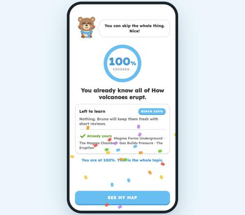
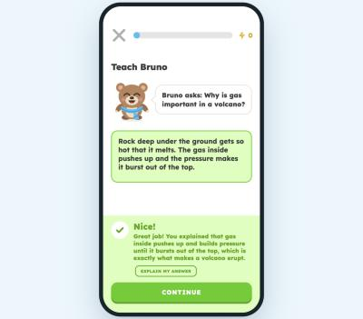
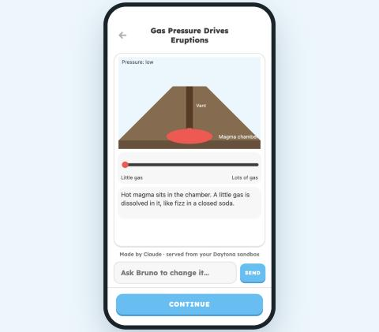
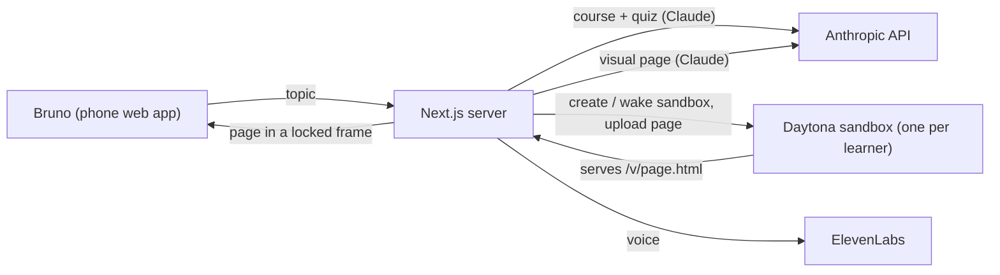

# Bruno: learn anything, see it, finish it

**Bruno** is a mobile learning app with a bear tutor. Type any topic. Bruno maps the whole topic, checks what you already know, teaches the rest, and lets you **play with an interactive visual that an AI builds for you live, inside a Daytona sandbox**. A coverage bar ends at 100%, so you know when you are done.

Everything a learner sees is generated on demand by an LLM: the course, every question, the grading of free-text answers, and the visuals.

Built for the **Daytona Hackathon (October 2026)**.

| Map reveal after the placement quiz | Claude grades "Teach Bruno" answers | AI-made visual, served from a Daytona sandbox |
|---|---|---|
|  |  |  |

---

## What happens when you learn with Bruno

1. **Pick any topic.** Example: "How volcanoes erupt".
2. **Bruno builds the course (about 25-30 s).** One Claude call writes 4 concepts with 16 questions, explanations and flashcards. A validator checks every question against the lesson engine and drops broken ones.
3. **Placement quiz.** One question per concept. A right answer gets one confirming question of a different kind, so a lucky guess never counts as "known".
4. **Map reveal.** Bruno shows what you already know and the exact list left to reach 100%.
5. **Interactive visual (15-30 s).** While you answer, Claude writes a small interactive HTML page for your topic. Bruno puts it into **your own Daytona sandbox**, and the app shows it from there. You can type "make the gas pressure higher" and Bruno redraws it.
6. **Lessons.** Seven exercise kinds: multiple choice, fill-in, typing, matching, build-the-sequence, listening and "Teach Bruno" (explain in your own words; Claude grades the meaning, not the exact words).
7. **Bruno talks.** Explanations are spoken with an ElevenLabs voice.

---

## Why Daytona is at the core

Every visual is **code written by an AI a few seconds ago**. We never run that code inside our app. Daytona gives every learner an isolated computer in the cloud that builds, hosts and serves it.



- **One sandbox per learner.** The browser remembers its sandbox and reuses it, so a reload takes about 1 s instead of a new start.
- **Fast cold starts from a snapshot.** `scripts/make-template.mts` builds the snapshot `learn-lab-template` (Vite, React, Tailwind, D3, Framer Motion, KaTeX, a UI kit and a lint + build check) with 1 vCPU, 2 GiB memory and 5 GiB disk. A new learner's sandbox starts from it in about 20 s.
- **Isolation.** AI-generated pages live and run in the sandbox. Our server fetches a page with Daytona's skip-warning header and shows it in a `sandbox="allow-scripts"` frame with no origin, so a generated page cannot touch the app or the learner's data.
- **Lifecycle and cost control.** Sandboxes auto-stop after 30 minutes and are deleted 60 minutes later. All our sandboxes carry the label `app=learn-lab`, and the app only ever stops or deletes sandboxes with that label, so other projects on the same Daytona account are never touched.
- **Agent workspace (the `/lab` builder).** For larger lessons, a Claude agent with `write_file`, `read_file`, `edit_file` and `run_command` tools builds a full React lesson **inside the sandbox**. After every change it runs a linter and a production build in the sandbox, sends errors back to Claude to fix (up to 3 times), and rolls back to the last working version if it still fails.

---

## Tech

| Part | What we use |
|---|---|
| Front end | Bruno mobile design, plain HTML/CSS/JS (installable PWA), in `learn-lab/public/bruno` |
| Server | Next.js 16 route handlers in `learn-lab/app/api` |
| LLM | Claude Opus 5.5 via the Anthropic SDK, structured outputs (Zod), server-side refusal fallbacks |
| Sandboxes | Daytona TypeScript SDK (`@daytona/sdk`), custom snapshot, preview links |
| Voice | ElevenLabs text-to-speech (Flash v2.5) |

### API routes

| Route | Does |
|---|---|
| `POST /api/bruno/topic` | `{name, level}` → a full topic in Bruno's format (Claude) |
| `POST /api/bruno/grade` | Grades a "Teach Bruno" answer: `{score, feedback, matched}` (Claude) |
| `POST /api/bruno/speak` | Text → MP3 (ElevenLabs) |
| `POST /api/visual` | Claude writes an HTML visual and uploads it to the learner's Daytona sandbox |
| `GET /api/page` | Passes a visual page from the sandbox to the app (allow-list only) |
| `POST /api/session`, `POST /api/chat` | The `/lab` agent builder: sandbox session and agent run with checks |

### Measured on a laptop with live services

| Step | Time |
|---|---|
| Course + quiz generation | 24-30 s |
| Visual (existing sandbox) | 13-15 s |
| Visual (new sandbox) | about 30 s |
| Visual change request | 20-25 s |
| "Teach Bruno" grading | about 4.5 s |
| Voice | 0.6-2 s |

---

## Run it

Needs Node.js 20+ and an Anthropic API key. Daytona and ElevenLabs keys are optional.

```bash
cd learn-lab
npm install
cp .env.local.example .env.local   # put your keys in .env.local
npm run dev                         # open http://localhost:3737
```

| Key | Needed for |
|---|---|
| `ANTHROPIC_API_KEY` | Everything (required) |
| `DAYTONA_API_KEY` | Visuals in Daytona sandboxes. Without it, visuals run in local test mode on your machine. |
| `ELEVENLABS_API_KEY` | Bruno's voice. Without it, the browser voice is used. |

With a Daytona key, build the template snapshot once:

```bash
npx tsx --env-file=.env.local scripts/make-template.mts
```

Deploy: import the repo on Vercel, set **Root Directory** to `learn-lab`, add the three keys, and deploy.

---

## Next: speech on Nosana

Speaking a topic or an answer instead of typing it. The plan is speech-to-text with Whisper on a Nosana GPU (an RTX 3060 is enough for the `small` model). The job definition is ready in [`nosana/whisper-job.json`](nosana/whisper-job.json); the app would send recordings to the Whisper endpoint from the server, so the endpoint stays private.

---

## Repo map

```
learn-lab/
  public/bruno/        Bruno app (screens, lesson engine, art, PWA)
  app/api/bruno/       topic, grade, speak
  app/api/visual, page Daytona visual pipeline
  app/lab/             agent builder UI
  lib/course.ts        course generator + validator
  lib/visual.ts        visual generator + Daytona upload
  lib/sandbox.ts       sandbox create / reuse / wake (+ local test mode)
  lib/agent.ts         sandbox agent with tools, checks and rollback
  scripts/             first-sandbox test, template snapshot builder
  template/            the app that goes into every sandbox (UI kit inside)
nosana/                Whisper job definition (next step)
DEMO.md                3-minute demo script
HACKATHON_GUIDE.md     step-by-step setup guide
```

**Still demo-only from the original design:** streak, gems, shop, league, quests, and the "Talk with Bruno" call.
